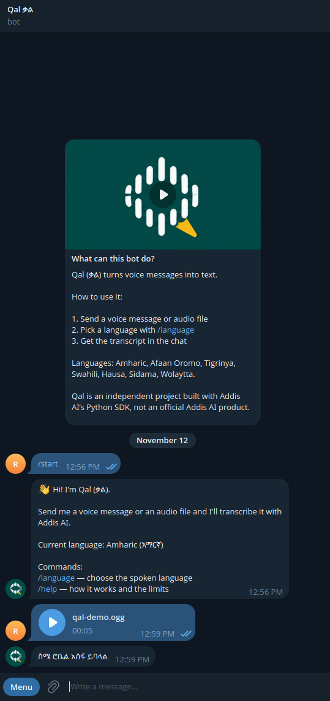
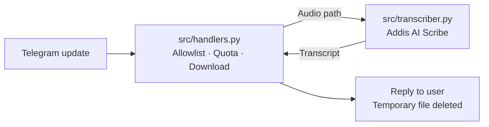

# Qal (ቃል)

Qal transcribes voice messages and audio files in Telegram using the Addis AI SDK. It supports seven languages:

- `am` — Amharic (default)
- `om` — Afaan Oromo
- `ti` — Tigrinya
- `sw` — Swahili
- `ha` — Hausa
- `sid` — Sidama
- `wal` — Wolaytta

*Qal is an independent project built with Addis AI's Python SDK. It is not an official Addis AI product.*

## Demo



## What it does

1. You send a voice message or an audio file.
2. The bot checks the allowlist, duration, size, and quota.
3. It downloads the audio to a temp folder.
4. It sends the audio to Addis AI Scribe in a background thread.
5. It replies with the transcript and deletes the audio.

### Commands

| Command | What it does |
|---|---|
| `/start` | Welcome and current language |
| `/help` | Usage, limits, privacy |
| `/language` | Inline buttons for all seven languages |

### Translation

After a transcript in Amharic, Afaan Oromo, or Tigrinya, Qal shows a "Translate to English" button. Translation runs only when you tap it, costs Addis AI credits, and counts toward your hourly and daily limits. Transcripts are kept in memory for 15 minutes and never written to disk.

### Behaviour

| Situation | What the user sees |
|---|---|
| Voice or audio file | A transcript reply |
| Plain text | A reminder to send audio |
| Audio too long | A clear “too long” message |
| File larger than 20 MB | A Telegram download-limit message |
| More than 5 requests an hour | A message with an approximate wait time |
| Shared daily limit reached | “Qal has reached today's limit. Please try again tomorrow.” |
| User not on the allowlist (only if `ALLOWED_USER_IDS` is set) | “Qal is a private bot. Ask the owner for access.” |
| Addis AI credits finished | A top-up message; the owner is also alerted |
| Rate limited by Addis AI | A “try again in N seconds” message |
| Network or API failure | A short, non-technical error message |
| Connection drops after sending | The bot checks the same request and returns the transcript if it finished |
| Unexpected bot error | A short apology; the owner gets one alert at most every five minutes |
| No speech detected | “I could not hear any speech in that audio.” |
| Transcript in am/om/ti | A "Translate to English" button appears |

## How it works



Each paid request carries a `request_id`. If the connection drops, the bot calls `scribe.recover(request_id)` instead of re-sending the audio. The SDK is synchronous, so calls run in a worker thread.

## Project layout

```text
qal-bot/
├── src/
│   ├── __init__.py
│   ├── __main__.py
│   ├── app.py
│   ├── config.py
│   ├── error.py
│   ├── formatting.py
│   ├── handlers.py
│   ├── languages.py
│   ├── rate_limit.py
│   ├── stats.py
│   └── transcriber.py
├── tests/
├── .github/workflows/tests.yml
├── requirements.txt
├── requirements-dev.txt
├── pytest.ini
├── .env.example
├── .gitignore
├── LICENSE
└── data/
```

## Requirements

- Python 3.10+ (tested on 3.14.4)
- A production Telegram bot token
- A development Telegram bot token for local work
- An Addis AI API key with credits

Pinned dependencies:

- `python-telegram-bot[webhooks]==22.8` — Bot API 10.0 support plus the tornado webhook server
- `addisai==0.14.0`
- `python-dotenv==1.2.4`

## Setup

1. `cd qal-bot`
2. Create a virtual environment and install `requirements-dev.txt`.
3. `cp .env.example .env`, then fill in `TELEGRAM_BOT_TOKEN`, `TELEGRAM_DEV_BOT_TOKEN`, and `ADDIS_API_KEY`.
   - `DEBUG=true` uses the dev token and long polling.
   - `DEBUG=false` uses the production token and the webhook.
4. Create two bots with @BotFather, one for production and one for development.
5. Get an Addis AI API key from [addisassistant.com](https://addisassistant.com).
6. Run `python -m src`.

## Webhook mode

Telegram pushes updates to a public HTTPS URL. Qal runs a small webhook server on `WEBHOOK_LISTEN:WEBHOOK_PORT`; the public URL goes in `WEBHOOK_URL`.

Local testing with [ngrok](https://ngrok.com):

```bash
# terminal 1
ngrok http 8080

# terminal 2
DEBUG=false WEBHOOK_URL=https://YOUR-NGROK-HOST/telegram \
  WEBHOOK_SECRET=choose-a-random-string python -m src
```

Production: put Caddy or nginx in front of `127.0.0.1:8080`.

```caddyfile
qal.example.com {
    reverse_proxy 127.0.0.1:8080
}
```

Then set `WEBHOOK_URL=https://qal.example.com/telegram` and a random `WEBHOOK_SECRET`. Telegram only accepts HTTPS webhook URLs. `WEBHOOK_SECRET` is sent back in the `X-Telegram-Bot-Api-Secret-Token` header and validated by the server.

### Azure App Service (free tier)

App Service gives you an HTTPS URL for free, so no reverse proxy is needed. The repo includes a GitHub Actions workflow (`.github/workflows/deploy.yml`) that deploys on push to `main`.

1. Create a resource group and a free (F1) App Service plan, then a Web App (Linux, Python 3.12).
2. Set the startup command to `python -m src`.
3. Add these app settings:
   - `TELEGRAM_BOT_TOKEN`, `ADDIS_API_KEY`
   - `DEBUG=false`
   - `WEBHOOK_URL=https://<app-name>.azurewebsites.net/telegram`
   - `WEBHOOK_SECRET` (a long random string)
   - `OWNER_USER_ID`, `ALLOWED_USER_IDS`
   - `DATA_DIR=/home/data` (so language choices survive redeploys)
4. In the repo, add two secrets under **Settings → Secrets and variables → Actions**:
   - `AZURE_WEBAPP_NAME` — the app name
   - `AZURE_WEBAPP_PUBLISH_PROFILE` — downloaded from the app's "Get publish profile"
5. Push to `main`. The workflow deploys automatically.

Notes: the free F1 tier sleeps after inactivity, so the first webhook reply after a quiet period may take a few seconds (cold start). `WEBSITE_INSTANCE_ID` is set by Azure, so the bot binds to `0.0.0.0` and uses the port Azure provides automatically.

## Configuration

The most important variables:

- `TELEGRAM_BOT_TOKEN` / `TELEGRAM_DEV_BOT_TOKEN` — production and development bot tokens.
- `ADDIS_API_KEY` — Addis AI key with credits.
- `DEBUG` — `true` for local polling, `false` for the webhook.
- `WEBHOOK_URL` and `WEBHOOK_SECRET` — required in webhook mode.
- `OWNER_USER_ID` — enables the hidden `/stats` command.
- `DATA_DIR` — where language choices and the daily budget are stored (defaults to `data/`, or `/home/data` on Azure).

The rest (`MAX_AUDIO_SECONDS`, `RATE_LIMIT_PER_HOUR`, `ALLOWED_USER_IDS`, `DAILY_TRANSCRIPTION_LIMIT`, `TRANSCRIBE_CONCURRENCY`, `WEBHOOK_LISTEN`, `WEBHOOK_PORT`) have sensible defaults. See `src/config.py` for all options.

Settings are read once at startup. Restart the bot after changing `.env`.

## Tests

```bash
python -m pytest -q
```

128 passed. The suite covers the seven language codes, the rate limiter and daily budget, `.env` parsing and token selection, allowlist rules, transcript splitting, audio suffix detection, transcription error mapping, paid-request recovery, the error handler, and the polling/webhook switch. CI runs `ruff check .` and the same suite on every push and pull request.

The tests do not call Telegram or Addis AI. The end-to-end path was tested manually with real tokens and voice messages.

## Notes

- Audio and transcripts are not stored. Only language choices are, in `data/languages.json`.
- The daily transcription budget is persisted to `data/daily_budget.json`, so a restart no longer wipes today's count. Per-user rate limits are still in memory.
- Run only one instance per bot token for two reasons: Telegram delivers each update to a single consumer, and in-memory state is not shared between processes.
- Audio is sent to Addis AI for transcription, so their service and privacy terms apply.

## What broke

The owner-alert cooldown looked correct on my machine but silently dropped every alert in CI. `time.monotonic()` doesn't start at zero — on a freshly booted runner it was under 300 seconds, so `now - 0.0 < 300` suppressed the very first alert. The fix was to treat a missing timestamp as "no previous alert" instead of just defaulting to `0.0`.

## License

MIT. See [LICENSE](LICENSE).
